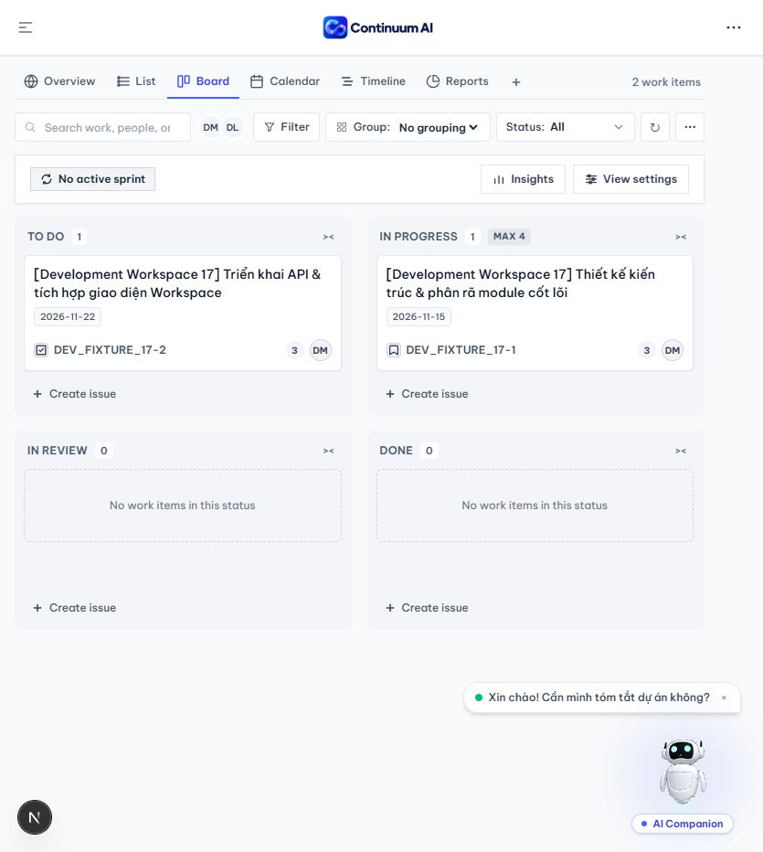
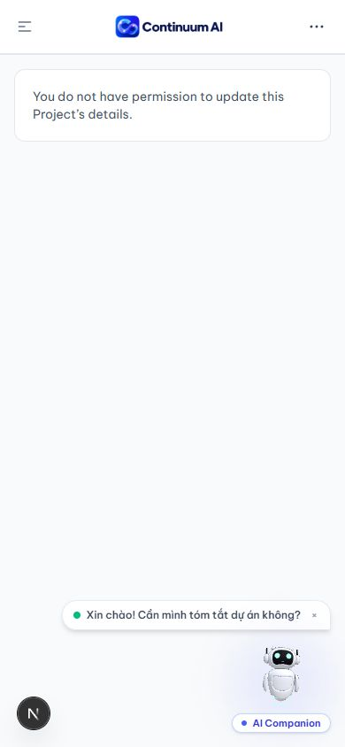

# Role permissions: Codex review and live browser QA

Execution dates: 2026-10-25–26 (Asia/Bangkok). This follows
[the initial audit](role-permission-audit-2026-10-25.md), on the same three local
FE, BE and documentation branches. The implementation and QA phase below
preceded commits and PR preparation; the later delivery status is recorded at
the end of this document.
The scope is the permission changes and their consumers, not a new redesign or
proof that every pre-existing application defect has been eliminated.

## Review method and findings

The installed Codex CLI ran independent, read-only `codex review` against the
uncommitted changes in each of DATN-FE, DATN-BE and product_docs, including
untracked source files. Follow-up FE reviews also read the relevant sibling BE
contracts and actual callers. Findings were checked against current accepted
policy and runtime behavior before deciding whether to change code.

| Finding | Disposition |
| --- | --- |
| P2: Task detail still offered Subtask creation when Task fields were read-only | User approved correction. Detail, List and Board now hide the action; the Workspace handler also checks the current Task projection. Existing-task attachment in detail is gated too. Regression tests cover read-only and editable Tasks. This is a UI restriction; no backend Task-create policy was changed. |
| P2: Manager exception did not enumerate Task Notes, Documents and Work Reports | User approved clarification. Each record's read/review rule is explicit, retaining Task scope validation, lifecycle and self-review restrictions. |
| P2: actor permission matrix contradicted the Manager exception | User approved clarification. Actor description, matrix and workflow now agree; current G4 Task authority is linked to the accepted 2026-10-22 Workspace contract rather than older generic proposals. |
| Live UI: ordinary Member could open Add member despite server denial | Fixed. An existing read-only candidate endpoint, guarded by the same `project.members.add` permission as the command, controls the button and modal. Errors/revocation hide them. No API was added and a listing permission is not substituted for add authority. |
| Live UI: Project Leader could select Leader in the Add member form | Fixed. Appointment authority defaults false; display, selection and submission are guarded. Parent passes current Manager authority. Tests also cover revocation of a previously selected Leader role. No actual appointment was made during QA. |
| Review suggestion: remove comments/worklogs from Tasks whose fields are read-only | Not adopted. `createTaskComment` and `createTaskWorklog` independently authorize Project context, not creator/assignee ownership. Removing them would change existing collaboration behavior. The projection's meaning is documented and a regression test preserves those callbacks. |
| Review suggestion: ownership helper alone does not revoke access after Project Membership removal | Actual caller revalidated: `WorkWorkspace` hides cached Tasks and all edit controls after the owning Task query returns 401/403/404. Added integration regressions refetch previously writable owned Tasks after revocation and assert the denial screen and absence of controls. This does not claim instantaneous cross-device invalidation before any revalidation occurs. |
| Final full FE review P2: Team controls inferred delegation from Project leadership | User approved correction on 2026-10-26. Scoped, successful Team list/detail reads now gate management, including direct create/edit routes. Current BE Team reads require both `team.read` and `team:children.manage`; the UI conservatively requires that read capability as well as leadership. Failed or revoked reads remove management and close an open create modal. No endpoint or Team release flag was added. |
| Final full FE review P2: standalone read-only Subtask Board cards remained draggable | User approved correction on 2026-10-26. Both drag-start and drop handlers check current Subtask permissions; unknown/stale payloads and read-only parent Task drops are ignored. An owned Subtask can still move even if parent Task fields are read-only. Tests cover an authority change between drag and drop. |
| Team follow-up: cached success remained actionable during a current access refetch | Refined within the approved Team correction: non-idle access reads disable management controls and the TeamForm submit handler, including retry commands. Forms stay mounted during pending revalidation so drafts survive and detail observers do not cause mount/refetch loops. Current detail reads independently gate detail-dialog writes. Cached create/edit, a denied read, and a pending open draft are covered by regressions. |
| Team follow-up: transient read failures discarded cached create/edit drafts | Corrected within the approved Team fix. Previously confirmed, actor-scoped cached data keeps drafts mounted after a network/5xx error, with all commands disabled until another successful read. Access denials still remove cached management. Create, edit and modal regressions check draft preservation, blocked submission and successful recovery. Direct create also exposes the existing refresh-error/retry UI. |
| Review suggestion: disable Cancel, close, backdrop and Escape during access revalidation | Not adopted. Intentional user dismissal is supported and does not execute a management command. The requirement is to disable commands and automatic permission-driven draft loss, not trap users in dialogs. An explicit regression verifies Escape still dismisses a disabled draft. |
| Team follow-up: directory actions used the old fixed page/filter access read | Corrected within the approved Team fix. The directory and its management gate share the actual currently selected page/status query. Pagination or status changes therefore cannot leave Create or row management authorized by an old page-1 ACTIVE result. Regressions cover pending and denied page/status reads. |
| Team follow-up: a hidden management modal reopened after permission recovery | Corrected. Loss of confirmed access clears the management dialog action and open state. The revocation test now recovers access and checks that the Create button returns but the dismissed dialog does not reopen. |
| Team follow-up: lifted directory selection could survive navigation to another Project | Corrected. Selection is keyed by actor, Organization, Project and workspace mode; a mismatching scope derives page 1 / ACTIVE before querying. A reused-workspace regression changes Project after selecting ALL/page 2 and checks the new Project's first ACTIVE page. |

BE review: no actionable finding. Final documentation review after clarification:
no actionable finding. Full FE review found the two final P2 items above; both
were approved and corrected. The first focused review accepted Board handling
and identified the cached-read gap recorded above. Another focused review found
transient draft loss, corrected above; its modal-dismissal suggestion was
assessed against the actual intended behavior rather than accepted as a new
requirement. The next review found the current-directory-query and modal-state
gaps above; both were corrected within the approved Team access work. The next
review found only the lifted-pagination regression, with no other actionable
permission/read-only defect. The last scoped review accepted its correction:
**no actionable new finding**, exit 0. Final review log:
`%TEMP%/continuum-role-fe-final-scope-review.log`; preceding permission review:
`%TEMP%/continuum-role-fe-2026-10-26-last-review.log`.

The CLI logged optional MCP authentication warnings during startup/shutdown;
local repository review completed independently of those optional connectors.
Codex review is not PR approval or a substitute for the separately named
`code-review-and-quality` skill gate in product_docs/AGENTS.md; that skill is
not installed, as recorded in the initial audit.

## Live environment and authentication

- FE at `http://localhost:3000`; BE monolith at `http://localhost:3002`, with
  persistence enabled. Existing Redis and MongoDB were used.
- BE was restarted with process-local `IAM_SERVICE_URL=http://127.0.0.1:3002`.
  Its previous default targeted inactive port 3001, producing Chat/Capture 503s.
  After correction, Chat ticket and Project Document requests returned 200.
  No populated `.env` file or authentication code was modified for QA.
- The user performed authentication for the real Member, Manager and Leader
  sessions. After the interrupted run expired, the user signed in again as
  Development Project Member. No session, token or credential was fabricated.
- A display name was not accepted as proof of leadership: the Development
  Project Leader account is a Member in DATN-KI8 but an effective Leader in
  Development Workspace 17. The rendered result and server permission probes
  correctly differ between those Projects.
- Actual viewport overrides were applied and checked using `innerWidth` and
  `innerHeight`: desktop 1440×900 and mobile 390×844. Screenshots were taken
  after layout settled. No page PASS is inferred merely from a successful resize.

## Route and interaction evidence

Project identifiers used below:

- `BE`: Backend, `6ad7758334bd88b3f2cc844d`, DATN-SPRING-2027.
- `GENERAL`: General, `6addb4e1601e4bc926ed4602`, DATN-SPRING-2027.
- `DEV17`: Development Workspace 17, `dfa8c4b61e428c76a3aa3bbf`, DATN Development.
- `KI8`: DATN-KI8, `6ad5ce7f4e98d4b07f5fc201`, DATN Development.

In the table, a denial PASS means the tested access was denied and no protected
form/data was exposed; it is not a visual PASS for the inaccessible feature.

| Actor / route | Open/data result | Browser interactions and viewports | Result / limitation |
| --- | --- | --- | --- |
| Signed out: `/dashboard`, `/organization/settings` | Session unavailable; `/auth/me` 401 | Desktop 1440×900; inspected session gate | Workspace hidden. No authenticated QA inferred. |
| Member: `/dashboard`, `/projects/BE/overview` | Public Project metadata available | Sidebar/header inspected; desktop and mobile; mobile sidebar toggled | No Organization administration or Project Settings. Add member leak reproduced, corrected, then verified absent. |
| Member: `/organization/settings` | Manager-only denial | Desktop inspection and screenshot | Denial PASS; no administrative form. |
| Member: `/projects/BE/settings` | Settings and visibility probes 403 | Desktop inspection and screenshot | Denial PASS; no editable form. |
| Member: `/projects/BE/work` | Tasks/Sprints 404; memberships 403 | Desktop error screen inspected | Member was not a Project member. No Task-content or mutation PASS claimed. |
| Manager: `/dashboard`, `/organization/settings` | Organization data and profile form available | Desktop 1440×900 and mobile 390×844; General and Member Access tabs inspected | Correct Organization navigation and forms. No Organization-setting or role mutation performed. |
| Manager: `/projects/GENERAL/work` | Task list/detail/history/comments/worklogs 200 | Desktop list and Task detail opened | Existing Tasks readable outside direct Project Membership; field controls available. No Manager Task mutation performed. Legacy UI still labels backend-connected items as preview data/details. |
| Manager: `/projects/GENERAL/documents` | Document list 200, empty state | Desktop inspected and screenshot | Same-Organization read reached the owning API. No document existed to test file access or review transitions. |
| Manager: `/projects/GENERAL/teams/new` | 404 page | Desktop opened and inspected | BLOCKED: development Team integration flag is off. This is not proof of role-specific Team denial; no flag or release gate was changed. |
| Leader: `/projects/DEV17/settings` | Settings/visibility/add-member probes 200 | Desktop and mobile; Name and Make private enabled; header tools link to current Project | Correct scoped tools. No metadata/visibility mutation performed. |
| Leader: `/projects/DEV17/members` | Member directory and add form available | Mobile; opened/closed add form, inspected role choices | Leader appointment option reproduced, fixed and verified absent; ordinary Project member option remains. No membership mutation performed. |
| Leader: `/projects/DEV17/work` | Tasks 200, including Tasks authored/assigned to Member | Desktop; changed fixture Task priority and restored it; reload checked | Two PATCH responses 200. Positive scoped Leader mutation verified. |
| Leader: `/projects/KI8/settings` | Permission denial in another Project where actor is only Member | Mobile 390×844, screenshot | Denial PASS; no inherited Leader Settings. |
| Leader: `/projects/GENERAL/settings` | Project not found/unavailable across Organizations | Desktop 1440×900, screenshot | Cross-Organization denial PASS; no Project content. |
| Member dev: `/projects/DEV17/work` | Own/assigned Tasks and memberships 200; settings/visibility 403 | Desktop; changed owned fixture Task priority and restored it; reload checked | Two PATCH responses 200. Positive Member mutation verified without management authority. |
| Member dev: `/projects/TEST/work` | Task access denied | Desktop opened | No Task mutation or contents exposed. Does not supply an other-owner editable Project fixture. |
| Member dev: `/projects/DEV17/overview`, `/settings` | Metadata available; settings/visibility denied | Mobile 390×844; Settings tab and Add member button both absent; direct Settings URL denied | Denial PASS within an actual active Project membership, not only a public non-member Project. |
| Member dev: `/projects/DEV17/work` Board and Task detail | Both existing Tasks available | Mobile 390×844; switched List → Board, opened owned Task detail and closed with Escape | Workflow inspected; page scroll width 375 within 390. No active Sprint, so its absence is not a live Sprint-permission PASS. |
| Member dev: `/platform` | No Platform Console data; redirected to `/select-organization` | Mobile route opened and redirect inspected | No implicit Platform admission. This does not certify the redirect UX or any authorized Platform Operator workflow. |
| Member dev: `/projects/DEV17/work` after Board correction | Existing Tasks still loaded | Reopened Board at the tab's actual 835×932 viewport; no console errors | Final-runtime smoke check. No read-only Subtask fixture was available; denial is regression-tested rather than claimed as a live drag test. |

No route not listed here is represented as browser-verified.

Screenshots are local evidence under
`C:/Users/DanhDEV/.codex/visualizations/2026/10/24/01a16f68-0a33-7e13-84ae-e007b36fdcfa/`:

- `role-qa-2026-10-25/`: Member administrative denials and Project overview,
  Manager Organization Settings/Documents/Tasks, Leader scoped Settings,
  corrected member-add role choice, cross-Project/cross-Organization denials,
  and the restored Leader Task fixture.
- `role-qa-2026-10-26/`: `member-owned-task-restored-desktop.jpg`,
  `member-dev-project-no-management-mobile.jpg`,
  `member-dev-own-project-settings-denied-mobile.jpg`,
  `member-owned-board-mobile.jpg`, `member-owned-task-detail-mobile.jpg`, and
  `member-board-final-runtime.jpg`.
- `manager-team-create-denied-desktop.jpg` captures a feature-gate 404, not a
  Manager permission rejection. Its filename must not be used to infer otherwise.

## Test data impact

Only two existing synthetic Development Tasks were edited through normal UI:

- `DEV_FIXTURE_17-1` (`6ada9643c9b1e702a639ca94`): Leader changed priority
  HIGH → MEDIUM → HIGH on 2026-10-25. Both requests returned 200; reload confirmed
  HIGH.
- `DEV_FIXTURE_17-2` (`6ada9643c9b1e702a639ca95`): Member changed priority
  MEDIUM → LOW → MEDIUM on 2026-10-26. Both requests returned 200; reload confirmed
  MEDIUM.

Task versions, updated timestamps and audit/history records reflect these
legitimate writes. They were not rewritten to conceal testing. No Task was
created/deleted, no account or membership/role was changed, and no seed or
migration was executed. Original priorities are restored.

## Automated verification

- FE `npm run check` before the final two approved corrections, 2026-10-26:
  PASS, exit 0; lint, typecheck, **858 tests /
  121 suites**, production build. Log: `%TEMP%/continuum-role-fe-2026-10-26-check.log`.
- A subsequent complete FE check passed **864 tests / 122 suites**, lint,
  typecheck and build, before the Team pending-read refinement. Targeted tests
  then passed **43 tests / 2 suites** for the final Team and Board behavior,
  including cached create/edit reads, transient failure recovery and intentional
  Escape dismissal, pagination/status reads, dismissal after revocation, and
  Project changes with non-default pagination/filter state.
  Log: `%TEMP%/continuum-role-fe-final-scope-targeted.log`.
  A full intermediate run passed lint/typecheck but timed out after 5 seconds
  in the existing filesystem-scanning `team-preview-boundary.spec.ts` test
  (866 passed, 1 failed); the isolated boundary rerun passed both tests in 356ms.
  Its test assertions/configuration and timeout were not changed. A later
  four-worker run passed lint/typecheck and 868 tests but hit three 5-second
  timeouts in existing WorkToolbar/ReferenceTrend tests (120 suites passed,
  two failed); Windows reported 704MB free physical memory during that run.
  The subsequent one-worker `npm run check` **passed, exit 0**: lint, typecheck,
  **873 tests / 122 suites**, and production build (55/55 static pages). Log:
  `%TEMP%/continuum-role-fe-2026-10-26-confirmed-check.log`. During that long
  run the last pagination-scope correction and one additional regression were
  added after its Team suite had executed; the affected Team/Board suites were
  separately rerun on the final source (**43 passed**, as above). Thus 873 is
  the actual full-run count, not a claim that a single full run executed all
  874 tests now present. Build compiled the final source. A fresh full lint
  and typecheck on the final source also **passed, exit 0**; log:
  `%TEMP%/continuum-role-fe-final-lint-typecheck.log`.
  Vitest's existing process-local limit was one worker. No test was excluded,
  no timeout was raised and no repository configuration was changed.
- BE source is unchanged since its full passing check in the initial record:
  **1,454 unit tests passed / 135 skipped; 108 E2E passed / 4 skipped**, with
  lint/typecheck/build passing. Skipped integrations were not executed.
- BE authorization regression rerun: **92 tests / 4 suites PASS**, covering
  current identity roles, role resolution, Task IAM bridge and Work Notes
  authorization. Log: `%TEMP%/continuum-role-be-review-regressions.log`.
- Intermediate newly added regressions were observed failing before fixes;
  lint/typecheck failures during iteration were corrected before the final
  passing FE check. Historical failed logs are not treated as final PASS.
- `git diff --check` passes in FE, BE and product_docs. FE `/signin` and BE
  `/api/v1/health` were rechecked as HTTP 200 on 2026-10-26.
- The final Member Board smoke was repeated with the authorized session after
  the Team fixes. Existing Task data loaded and captured console errors were
  empty; its screenshot is `member-board-final-runtime.jpg` (835×932).

## Remaining coverage boundaries

- Team routes remain disabled by `teamDevelopmentEnabled()` while
  `TEAM_FOUNDATION_DEV_INTEGRATION` is unset; no Team browser PASS.
- No live role downgrade/revocation or account suspension was performed.
  Cached-access removal is covered by regression tests, not a fabricated live
  role-change scenario.
- The current Member fixture has owned/assigned Tasks; another readable Task
  owned solely by someone else has not yet been found. Other-owner Task/Subtask
  denial is covered by automated tests, not claimed as live browser acceptance.
- No real document/report approval, reject, file upload/download, Sprint
  completion or role appointment was performed. Empty data or absence of an
  active Sprint is not a successful authorization test of those mutations.
- Real backend-connected Tasks still carry legacy preview wording in existing
  UI; this copy defect was observed and not counted as an authorization failure.
- `THREE.Clock` deprecation warnings were observed from the existing AI companion.
  Transient network failures during BE restart and the earlier incorrect IAM
  target are distinguished from permission denials.
- At the end of implementation QA, changes were local and uncommitted. Public `/`, `/signin` and
  `/platform/signin` sources, dependencies, governance files, schemas and
  migration history are outside these corrections.

## PR preparation and latest-main integration (2026-10-26)

The user explicitly requested PR creation, then required fetching and merging
the latest `main` into the existing task branches first. The original changes
were committed before integration, without stashing, resetting or discarding
any working-tree files.

| Repository | Current branch | Fetched main | Local integration |
| --- | --- | --- | --- |
| DATN-FE | `feat/Danh-role-permission-audit-fe-ui` | `87392d1522739f0deba6fee3bc96340c260bc789` | Permission commit `0eaa98b`, then merge `c192106`; incoming Jira CSV import preserved; no textual conflicts. |
| DATN-BE | `feat/Danh-role-permission-audit-be-api` | `026fca536f625430d66d07ed6b11ca27830b6e7a` | Permission commit `dc24a66`; already contains fetched main. |
| Document | `feat/Danh-role-permission-audit-docs` | `b08110f88f48599484e400e3bdb3386466ebfadb` | Documentation commit `d97d7c0`; already contains fetched main. |

The fresh full FE `npm run check` **passed, exit 0**: lint, typecheck,
**881 tests / 123 suites**, and production build. This run covers the final
merged source, including incoming Jira import tests and the final Team
pagination regression. These counts supersede the historical FE counts above.
Process-local Vitest limits were maximum two workers, minimum one, with no
excluded tests or raised timeouts. Log:
`%TEMP%/continuum-role-fe-pr-main-sync-check.log`.

The post-merge Codex CLI integration review completed with **no actionable
integration regression**, exit 0. It checked that incoming Jira CSV import and
Task refresh behavior coexist with permission projection, denied-access gates,
read-only Task/Subtask controls and scoped Sprint completion. Log:
`%TEMP%/continuum-role-fe-pr-main-sync-review.log`.

BE source and fetched main were unchanged since the earlier complete passing
check. Its four affected authorization suites were rerun before PR preparation:
**92 tests / 4 suites passed**, exit 0. Log:
`%TEMP%/continuum-role-be-pr-regressions.log`. Expected negative OAuth mock
events in this log are unit-test scenarios, not a new live sign-in failure.
All three branches passed diff checks against their fetched main. A subsequent
Document commit only aligns indentation in the already-reviewed role hierarchy.

PRs will target `main` as **drafts**: the named `code-review-and-quality` skill
required by product_docs/AGENTS.md is still not installed. The completed Codex
CLI reviews are evidence, not a claim that this separate formal gate passed.
No PR approval, auto-merge or merge into main is authorized or performed.
There is no schema, migration or dependency change. No Jira ticket was supplied;
PR links can be added to the appropriate ticket by the user.

Portable screenshots from the previously recorded live sessions:

